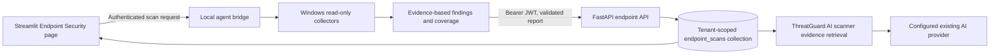

# ThreatGuard Windows Endpoint Agent

The agent runs on Windows 10/11 with Python 3.11 or newer. It performs read-only checks on the local computer, submits a bounded report to the authenticated ThreatGuard API, and does not execute remediation.

## Architecture



## Install

From PowerShell at the repository root:

```powershell
cd endpoint-agent
py -3.11 -m venv .venv
.\.venv\Scripts\Activate.ps1
pip install -r requirements.txt
Copy-Item .env.example .env
```

Set `THREATGUARD_URL` in `endpoint-agent/.env` if the API is not at `http://127.0.0.1:8000`. For a remote backend, use HTTPS and configure a trusted certificate. The agent never writes credentials to its `.env` file.

## Commands

```powershell
python agent.py --check-connection
python agent.py --system-info
python agent.py --scan
python agent.py --serve
python agent.py --periodic --interval-minutes 60
```

`--scan` asks for consent before collecting host information and again before upload. It prompts for account email and password; the password is used only for sign-in, and the JWT remains in process memory. Optional `THREATGUARD_EMAIL`, `THREATGUARD_ORG_ID`, and `THREATGUARD_TENANT_ID` values can help identify the account, but the password is always prompted.

`--serve` is an opt-in, foreground local bridge used by the dashboard's Run Security Scan button. It asks for consent at startup, then waits for a scan request carrying the signed-in user's ThreatGuard token. Each request is checked against `/auth/me`; the backend independently applies its existing role and tenant authorization. Stop the bridge with Ctrl+C. It does not install a service, task, or startup entry. The default port is 8765 and can be changed with `THREATGUARD_AGENT_PORT`. The dashboard container reaches it at `host.docker.internal:8765` on Docker Desktop.

`--periodic` is an explicit foreground-only opt-in. It asks before each scan and before each upload, prompts for sign-in for every cycle, and stops with Ctrl+C. `--interval-minutes` accepts 1 through 1440. It creates no background schedule or automatic startup.

## Checks and findings

- Windows edition, version, and build where PowerShell exposes them; basic adapter name, status, and link speed; BitLocker state when accessible.
- Defender antivirus and real-time protection, signature age, firewall profiles, and UAC where accessible.
- Installed application names, versions, and publishers from supported uninstall registry entries.
- Local TCP listeners and their owning process names and IDs.
- All-interface listeners for selected sensitive services are configuration warnings; the agent does not test external reachability.
- OSV checks run only when a package has an explicit ecosystem, package name, and version. Windows display names are not guessed into package coordinates. Unmatched or unreachable intelligence is reported as unknown/requiring verification.

Unknown, unsupported, and failed collectors remain visible as coverage. They are not interpreted as secure. Findings include evidence, confidence, rationale, severity, affected component, remediation guidance, and intelligence provenance. No exploit data is downloaded or executed.

## Permissions

Run as a normal user first. Some Defender, firewall, registry, and process-owner fields may be unavailable or incomplete without administrator rights; the agent reports unknown coverage instead of requesting elevation. No administrator-only action is required for unit tests.

## Data and privacy

The uploaded report contains a host name, OS details, findings, limited installed application metadata, selected listening socket metadata, coverage status, and scan timestamps. It does not collect file contents, browser data, documents, credentials, environment variables, or command lines. Raw inventory is bounded to 500 entries per list and stored in the `endpoint_scans` collection with organization, tenant, and uploader identity. The endpoint API and chatbot limit endpoint scan access to the authenticated uploader within that tenant. Legacy native scanner records are scoped to organization and tenant. AI explanations are separate from observed evidence and cannot run commands or remediate the computer.

For demonstration on a private machine, keep the bridge running only while using the dashboard. The bridge requires a valid ThreatGuard JWT for scan and status requests; `/health` reveals only whether the process is ready. HTTP is suitable for loopback development; use HTTPS for remote backend URLs.

## Limitations

The agent does not determine patch compliance from Windows Update history, BitLocker state, or Windows Security Center because those checks are not reliably exposed in the unprivileged collector. These remain unknown. Application vulnerability matching is intentionally conservative: registry display names alone cannot establish package identity or affected version ranges. OSV matches are exact package-coordinate/version lookups only. A no-match result is not proof that software is free of vulnerabilities. Scan history is retained per tenant and can be compared by selecting earlier scans in the dashboard; the agent does not infer a change when scan evidence is missing.
